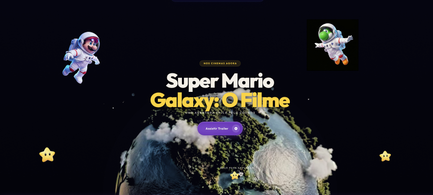

# Super Mario Galaxy: O Filme

Landing page conceitual inspirada no universo de *Super Mario Galaxy*. O projeto apresenta uma experiência visual temática com personagens, trailers e uma contagem regressiva para a estreia.

> Projeto educacional e não oficial. Mario, Nintendo e personagens relacionados são marcas registradas de seus respectivos proprietários.



## Funcionalidades

- Página inicial com animações e elementos visuais de tema espacial.
- Navegação entre as seções da página.
- Apresentação de personagens.
- Carrossel com trailers incorporados do YouTube.
- Contagem regressiva para a data de estreia configurada no projeto.
- Layout responsivo para diferentes tamanhos de tela.
- Recursos de acessibilidade, como textos alternativos, rótulos e suporte a movimento reduzido.

## Tecnologias

- HTML5
- CSS3
- JavaScript
- [GSAP](https://gsap.com/) e ScrollTrigger para animações
- [particles.js](https://vincentgarreau.com/particles.js/) para partículas
- Google Fonts — fonte Outfit
- YouTube para os vídeos incorporados

As bibliotecas, a fonte e os vídeos incorporados são carregados de serviços externos. Uma conexão com a internet é necessária para que esses recursos estejam disponíveis.

## Como executar

O projeto não requer instalação de dependências nem processo de build.

1. Clone o repositório:

   ```bash
   git clone <URL_DO_REPOSITORIO>
   ```

2. Entre na pasta do projeto:

   ```bash
   cd <PASTA_DO_PROJETO>
   ```

3. Abra `index.html` no navegador. Para uma experiência mais consistente, sirva os arquivos por um servidor local, por exemplo:

   ```bash
   python -m http.server 8000
   ```

4. Acesse [http://localhost:8000](http://localhost:8000).

Também é possível abrir a pasta no Visual Studio Code e usar uma extensão de servidor local, como o Live Server.

## Estrutura do projeto

```text
.
├── assets/
│   ├── images/       # Imagens dos personagens e elementos visuais
│   └── videos/       # Vídeos usados na composição da página
├── css/
│   └── styles.css    # Estilos e regras responsivas
├── docs/             # Especificações das seções e componentes
├── js/
│   ├── script.js     # Interações, animações e contagem regressiva
│   └── scroll-animations.js
├── prints/           # Capturas de tela e referências visuais
├── DESIGN.md         # Tokens e diretrizes visuais
└── index.html        # Documento principal
```

## Publicação no GitHub Pages

1. Envie os arquivos do projeto para um repositório no GitHub.
2. No repositório, acesse **Settings → Pages**.
3. Em **Build and deployment**, selecione **Deploy from a branch**.
4. Escolha a branch desejada e a pasta `/ (root)`, depois salve.

Como o site é estático e o arquivo `index.html` está na raiz, não é necessário configurar um comando de build.

## Créditos e observações

Este é um projeto conceitual criado para fins educacionais, sem vínculo oficial com a Nintendo. Os vídeos são carregados pelo YouTube; imagens e vídeos locais estão organizados em `assets/`.
